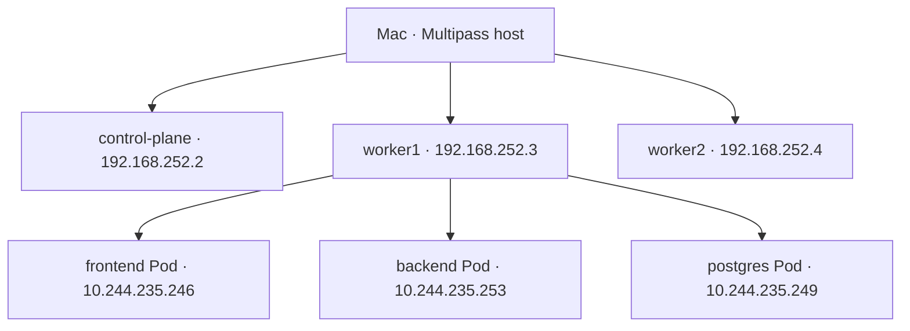
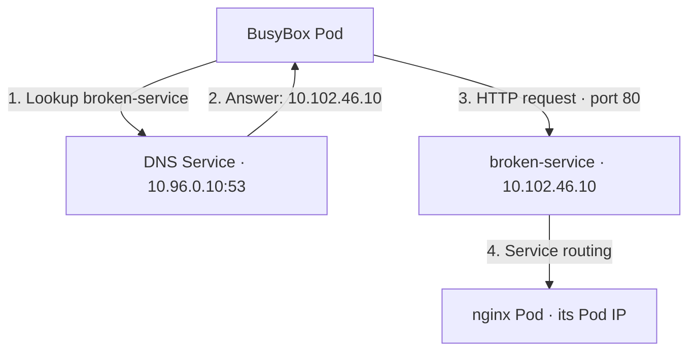

# 05 — Node IP, Pod IP, Service IP, and DNS

## Four different concepts

| Concept | What it identifies or does | Lab example |
|---|---|---|
| Node IP | Ubuntu virtual machine | worker1: `192.168.252.3` |
| Pod IP | One Pod's network address | backend: `10.244.235.253` |
| Service ClusterIP | Virtual application entry address | backend: `10.107.208.50` |
| DNS | Translates names to addresses | backend name resolves to its Service IP |

A Pod runs on a node but normally has a separate IP. A Service is a virtual routing entry, not another VM. DNS is a lookup mechanism, not an additional kind of destination IP.

## Your physical layout



These placements and Pod addresses are snapshots from our session. Replacement Pods may receive different addresses.

## DNS lookup versus application request



DNS does not relay the HTTP request. It answers the name lookup first; the client then connects to the returned address.

```bash
kubectl exec -n troubleshooting broken-command -- nslookup broken-service
kubectl exec -n troubleshooting broken-command -- nslookup broken-service.default.svc.cluster.local
kubectl exec -n troubleshooting broken-command -- nslookup broken-service.troubleshooting.svc.cluster.local
```

Our full correct name resolved to `10.102.46.10`. The `default` namespace lookup returned NXDOMAIN because that Service did not exist there. This was a wrong name, not a broken DNS server.

| Name part | Meaning |
|---|---|
| broken-service | Service name |
| troubleshooting | Namespace |
| svc.cluster.local | Service suffix in this cluster |

Short Service names work within the client's namespace using DNS search suffixes. For another namespace, use `service.namespace` or its full name.

For ordinary ClusterIP Services, DNS returns the Service IP. Headless Services can return backend Pod IPs; leave that advanced case for a later lesson. Arbitrary node names are not automatically Service records in cluster DNS.

## NodePort

Your frontend Service showed `80:31554/TCP`:

| Setting | Address or purpose |
|---|---|
| Node IP | worker1: `192.168.252.3` |
| NodePort | `31554` |
| Service address | `10.107.196.100:80` |
| Frontend Pod destination | `10.244.235.246:80` |

A client with network access to the node can request `http://192.168.252.3:31554`. Service routing sends the traffic to a selected frontend Pod; it does not require that Pod to be on the contacted node under the default Cluster traffic policy. A firewall or host routing issue can still block access. We verified the application with port-forward, not a NodePort request, in this session.

## /etc/hosts and loopback

`/etc/hosts` is a manual, local name-to-IP file. It is separate on your Mac and each Ubuntu VM. Cluster Service records are provided by cluster DNS, so they are not listed in the Mac or node hosts files.

- `127.0.0.1` and `127.0.1.1` are loopback addresses: they refer to the machine using them.
- On the Mac, `localhost` means the Mac. On worker1, it means worker1.
- `127.0.1.1 control-plane` lets the Ubuntu machine resolve its own name locally; its external node address remains `192.168.252.2`.
- Docker Desktop's `kubernetes.docker.internal` entry is separate from the Multipass homelab.
- Adding a name to a hosts file does not create a network route to its IP.

No hosts-file modifications were needed.
