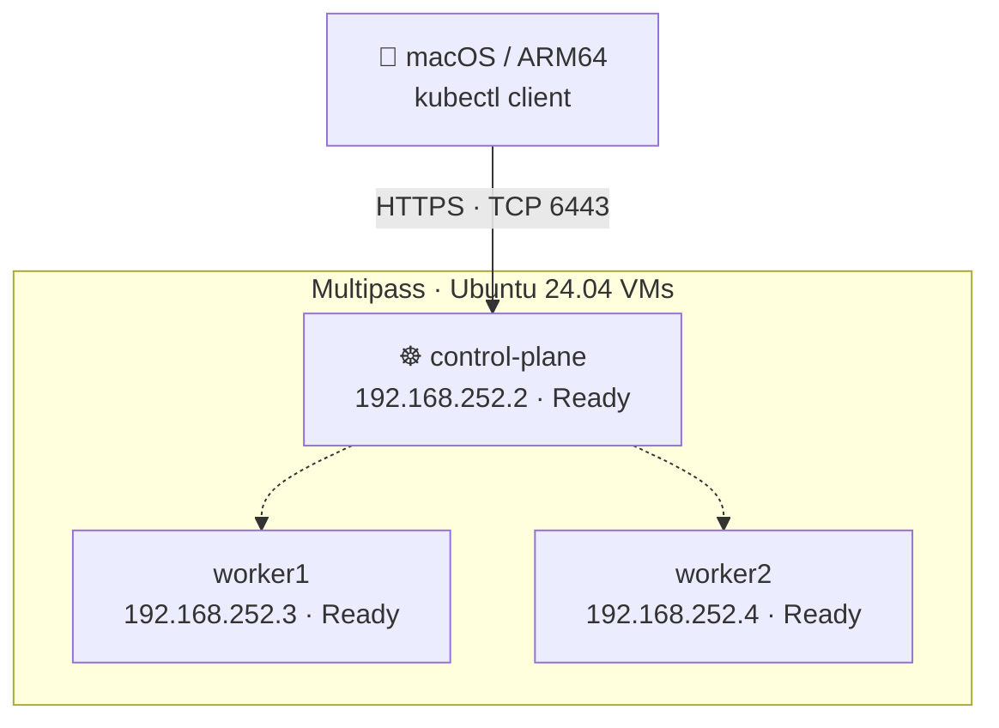

# ☸️ k8s-homelab

### A hands-on Kubernetes learning journey — built from scratch on Apple Silicon

[](https://kubernetes.io/)
[](https://ubuntu.com/)
[](docs/architecture.md)


> **Learn Kubernetes by building, breaking, understanding, and fixing it.** This repository documents a real three-node `kubeadm` homelab, with readable chapters, commands, architecture diagrams and verified results. It is a learning environment, not a production deployment guide.

## What I built



**Verified 2 November 2026:** Kubernetes **v1.37.2**, containerd **2.2.1**, Calico **v3.33.0**, all **three nodes Ready**. VM addresses are from this lab and may be different on your machine.

## Technology stack

| Layer | Technology | Why it's here |
|---|---|---|
| Host | Apple Silicon Mac, 8 GB RAM | Local learning machine |
| Virtual machines | Multipass + Ubuntu 24.04 ARM64 | Three lightweight Linux nodes |
| Cluster bootstrap | kubeadm | Initialize and join Kubernetes nodes |
| Container runtime | containerd + runc | Run containers through the CRI |
| Networking | Calico + CoreDNS + kube-proxy | Pod networking, DNS and Services |
| Administration | kubectl (macOS + VMs) | Manage the cluster |
| Version control | Git + GitHub | Publish learning notes and manifests |

See the [architecture and networking diagram](docs/architecture.md) for hardware sizes, CIDRs and component relationships.

## Learning path

| Module | Topics | Status |
|---|---|---|
| [01 · Cluster Setup](01-cluster-setup/README.md) | Multipass, Linux prerequisites, containerd, kubeadm, Calico, workers, kubectl | ✅ Completed |
| [02 · Workloads](02-workloads/README.md) | Pods, Deployments, probes, scaling, scheduling | ⏳ Planned |
| [03 · Networking](03-networking/README.md) | Services, DNS, NetworkPolicies, Ingress, Gateway API | ⏳ Planned |
| [04 · Storage](04-storage/README.md) | PV/PVC, StorageClass, NFS, StatefulSets | ⏳ Planned |
| [05 · Security & Cluster Ops](05-security-and-cluster-ops/README.md) | RBAC, Helm, Kustomize, etcd, upgrades | ⏳ Planned |
| [06 · Troubleshooting](06-troubleshooting/README.md) | Break/fix scenarios and real incidents | 🛠️ In progress |
| [07 · Observability](07-observability/README.md) | Metrics Server, Prometheus and Grafana | ⏳ Bonus |

### Start learning

Begin with **[Module 01 — Cluster Setup](01-cluster-setup/README.md)**. Its lessons are separated into **nine short chapters**, from the host requirements to direct `kubectl` access from macOS. Every chapter explains *why* a command is used, not only *what* to type.

## The real incident: worker1 NotReady

A worker VM was accidentally created with **5 GB** rather than **15 GB** of disk. The root filesystem reached **100%**, causing `DiskPressure=True` and delaying Calico initialization. We diagnosed it with `kubectl describe node`, `df -h` and `lsblk`, then expanded the virtual disk, partition and ext4 filesystem. Worker1 recovered to `Ready` without reinstalling Kubernetes.

**[Read the full DiskPressure troubleshooting walkthrough](06-troubleshooting/worker-disk-pressure.md)**.

## Quick result check

After configuring your *own* kubeconfig, run:

```bash
kubectl get nodes
# control-plane   Ready   control-plane   ...   v1.37.2
# worker1         Ready   <none>          ...   v1.37.2
# worker2         Ready   <none>          ...   v1.37.2
```

See [Chapter 08](01-cluster-setup/08-macos-kubectl.md) for secure kubeconfig setup and the `KUBECONFIG` shortcut. **Never commit kubeconfigs, join tokens, admin certificates, or private keys.**

## Project principles

- **Understand first:** explain every Linux and Kubernetes command.
- **Practice on real nodes:** verify results instead of assuming success.
- **Break and fix:** record failures and their root causes.
- **Publish responsibly:** reproducible manifests, no secrets.
- **Keep learning:** future modules are clearly labeled as planned until completed.

## Official references

[Kubernetes documentation](https://kubernetes.io/docs/) · [kubeadm installation](https://kubernetes.io/docs/setup/production-environment/tools/kubeadm/install-kubeadm/) · [Calico documentation](https://docs.tigera.io/calico/latest/) · [Multipass documentation](https://documentation.ubuntu.com/multipass/)

---

*Built as a practical CKA learning journal. Tested in a local lab on 2 November 2026.*
