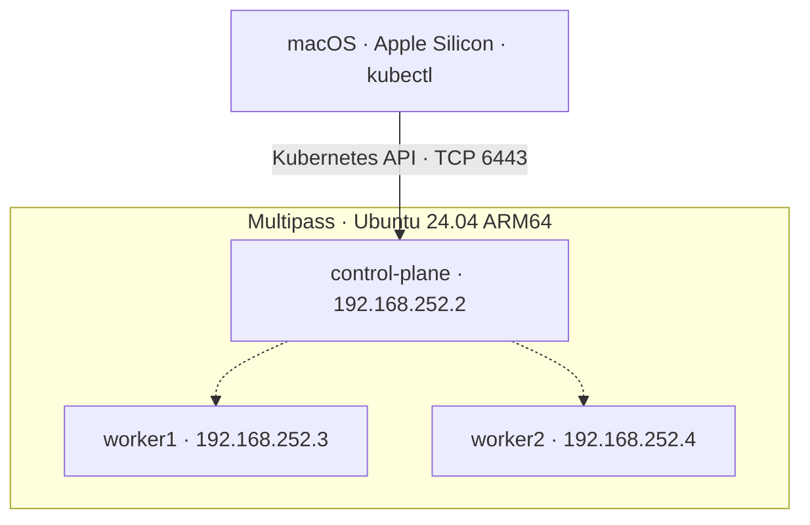

# ☸️ Kubernetes Homelab

### A practical learning path from an empty VM to a working Kubernetes application

[](docs/architecture.md)
[](https://ubuntu.com/)
[](https://kubernetes.io/docs/setup/production-environment/tools/kubeadm/)


> **Build it. Understand it. Break it. Fix it.**
>
> This repository follows a real three-node Kubernetes homelab on Apple Silicon. Each chapter connects a concept to a practical task, an observable result, and a troubleshooting exercise. Together, the chapters form a hands-on CKA learning journal.

All seven chapters are completed. Start at Chapter 01 to rebuild the lab, or use the chapter checkpoints to review what you have learned. Completion records progress through this learning path; it does not imply that every optional extension or certification objective has been covered.

## What you will learn

By following the core exercises, you will learn to:

- Bootstrap a cluster with `kubeadm` and connect to it from macOS.
- Run and manage workloads using declarative manifests.
- Trace traffic through Pods, Services, DNS and Ingress.
- Connect an application to PostgreSQL and verify persistent storage.
- Practice access control and cluster administration.
- Diagnose failed workloads using status, events, logs and configuration.
- Observe cluster health and explore metrics and monitoring tools.

## The lab you will build



The diagram shows the lab nodes and administration entry point. It is not a complete traffic diagram; see [architecture and networking](docs/architecture.md) for component relationships and network details.

| Layer | Lab choice | Learning purpose |
|---|---|---|
| Host | Apple Silicon Mac, 8 GB RAM | Run a local ARM64 learning environment |
| Virtual machines | Multipass, Ubuntu 24.04 | Work with separate Linux nodes |
| Cluster bootstrap | kubeadm | Understand initialization and node joining |
| Container runtime | containerd and runc | Understand how Kubernetes runs containers |
| Networking | Calico, CoreDNS and kube-proxy | Explore Pod connectivity, name resolution and Services |
| Administration | kubectl on macOS and Linux | Inspect and manage cluster resources |
| Application | Frontend, Python backend and PostgreSQL | Connect workloads, networking and storage |
| Version control | Git and GitHub | Keep manifests and learning notes reproducible |

IP addresses, disk paths, image tags and resource sizes are examples from this lab. Adapt them to your environment. The host has limited memory, so check available capacity before running additional monitoring workloads.

## Before you begin

You should be comfortable navigating a terminal, editing text files, and using basic Git commands. Familiarity with containers helps; the chapters explain the Kubernetes concepts as they appear.

Begin with [Chapter 01](01-cluster-setup/README.md) for host preparation, VM sizing, software installation and kubeconfig setup. Build the cluster before attempting later exercises.

Use the software versions recorded in the chapter instructions as lab context. If you choose different versions, check the official documentation for compatibility before applying installation commands.

## The learning path

Work through the chapters in order on your first pass. Each chapter builds on resources or concepts introduced earlier.

| Chapter | What you practice | Review checkpoint | Status |
|---|---|---|---|
| [01 · Cluster Setup](01-cluster-setup/README.md) | Multipass, Linux preparation, containerd, kubeadm, Calico and kubectl | Explain how the cluster starts and verify that all three nodes are Ready | ✅ Completed |
| [02 · Workloads](02-workloads/README.md) | Pods, multi-container workloads, controllers, configuration, probes and scheduling | Deploy a workload, change it, and explain how Kubernetes maintains its desired state | ✅ Completed |
| [03 · Networking](03-networking/README.md) | Services, DNS, NetworkPolicies, application exposure and Ingress | Trace a request to the correct Pods and explain what permits or blocks it | ✅ Completed |
| [04 · Storage](04-storage/README.md) | PersistentVolumes, PersistentVolumeClaims, Secrets and PostgreSQL integration | Replace the database Pod and verify that the application data remains | ✅ Completed |
| [05 · Security & Cluster Operations](05-security-and-cluster-ops/README.md) | Access control and cluster administration exercises | Explain the permissions and operational checks used in the chapter | ✅ Completed |
| [06 · Troubleshooting](06-troubleshooting/README.md) | Image, command, scheduling and Service failures; node incidents | Find the root cause, apply a targeted fix, and verify recovery | ✅ Completed |
| [07 · Observability](07-observability/README.md) | Cluster health, events, logs, restarts, Metrics Server and monitoring tools | Choose the evidence needed to investigate an unhealthy workload | ✅ Completed |

The chapter READMEs define the detailed lesson order and any prerequisites. Optional extensions, such as Gateway API, NFS or alternative storage patterns, should be tracked separately from completion of the core chapter exercises.

## How to use each chapter as a tutorial

1. **Read the goal.** Describe the expected behavior before creating resources.
2. **Inspect the starting state.** Check your context, namespace and existing resources.
3. **Run one logical step.** Read the manifest and understand the command before executing it.
4. **Verify the result.** Use resource status, events, logs or an application request as evidence.
5. **Explain what happened.** Connect the observed result to the Kubernetes concept.
6. **Change or break one thing.** Predict the effect, investigate it, and restore the working state.
7. **Record and clean up.** Save useful notes and follow the chapter's cleanup instructions.

A successful `kubectl apply` confirms that the API accepted a resource. Continue checking until the intended workload or application behavior is visible.

## The application that connects the chapters

The demo application gives the later lessons a shared purpose:

| Component | Role | What it teaches |
|---|---|---|
| Frontend | Serves the user interface and forwards API requests | Application exposure and routing |
| Python backend | Handles `/api/jobs` requests | Deployments, configuration and Service connectivity |
| PostgreSQL | Stores job records | Secrets, persistent storage and database access |

Follow the application material in [Networking](03-networking/README.md), then continue with [Storage](04-storage/README.md). Use [Troubleshooting](06-troubleshooting/README.md) to practice diagnosing failures across the same components.

The storage exercise provides a useful end-to-end checkpoint: create data, replace the PostgreSQL Pod, then query the application again to verify that the data survives.

## A practical inspection routine

After configuring your own kubeconfig, confirm which cluster you are about to use:

```bash
kubectl config current-context
kubectl get nodes -o wide
kubectl get pods -A
```

For an application exercise, inspect its namespace. The demo application uses `jobs-demo`:

```bash
kubectl get deployments,pods,services -n jobs-demo
kubectl get pvc -n jobs-demo
kubectl get events -n jobs-demo --sort-by=.metadata.creationTimestamp
```

When something fails, narrow the investigation:

```bash
# Replace POD_NAME and CONTAINER_NAME with actual names.
kubectl describe pod POD_NAME -n jobs-demo
kubectl logs POD_NAME -n jobs-demo -c CONTAINER_NAME

# Use this when a previous container instance has terminated.
kubectl logs POD_NAME -n jobs-demo -c CONTAINER_NAME --previous
```

If Metrics Server is installed and available, inspect current resource usage:

```bash
kubectl top nodes
kubectl top pods -A
```

`kubectl top` depends on the metrics API. Follow [Observability](07-observability/README.md) for setup and investigation when metrics are unavailable.

## A real incident: worker1 NotReady

One worker VM was created with **5 GB of disk instead of 15 GB**. Its root filesystem reached **100% usage**, causing `DiskPressure=True` and delaying Calico initialization.

The investigation combined Kubernetes evidence from `kubectl describe node` with Linux checks using `df -h` and `lsblk`. Expanding the virtual disk, partition and ext4 filesystem restored the node to `Ready` without reinstalling Kubernetes.

[Read the DiskPressure troubleshooting walkthrough](06-troubleshooting/worker-disk-pressure.md).

The lesson: workload failures can originate in the underlying machine. Check node conditions and host resources when Pod-level evidence does not explain the problem.

## Review after completing all seven chapters

Use these tasks for a second pass. Try them from memory, then consult the relevant chapter to check your reasoning.

| Review task | Evidence of success | Revisit |
|---|---|---|
| Explain the control plane, workers, runtime and CNI | Describe each component's responsibility | 01 |
| Deploy and update a workload | The rollout completes and the application responds | 02 |
| Diagnose a Service that cannot reach its Pods | Selectors, endpoints and ports explain the failure | 03, 06 |
| Investigate a DNS or connectivity failure | Separate name resolution from network reachability | 03, 06 |
| Demonstrate database persistence | Records remain after database Pod replacement | 04 |
| Explain an access-control decision | Identify the identity, permission and resource involved | 05 |
| Repair an intentionally broken workload | Record the symptom, root cause, fix and recovery check | 06 |
| Investigate restarts or resource usage | Use events, logs and metrics to support your explanation | 07 |

For CKA practice, repeat selected tasks with a time limit and keep a short error journal. Review mistakes until you can explain the cause and verify the fix without copying a command sequence.

## Repository habits

- Keep manifests, explanations and verification steps together.
- Explain why commands are used and what their output proves.
- Use explicit namespaces when working on chapter exercises.
- Keep kubeconfigs, join tokens, credentials, private keys and real Secret values out of Git.
- Review cleanup commands before running them, especially for persistent data.
- Document optional future work separately from completed exercises.

## Official references

- [Kubernetes documentation](https://kubernetes.io/docs/)
- [kubeadm installation](https://kubernetes.io/docs/setup/production-environment/tools/kubeadm/install-kubeadm/)
- [kubectl reference](https://kubernetes.io/docs/reference/kubectl/)
- [Calico documentation](https://docs.tigera.io/calico/latest/)
- [Multipass documentation](https://documentation.ubuntu.com/multipass/)

---

Built as a practical Kubernetes and CKA learning journal. This is a local learning environment; production design requires additional operational planning.
