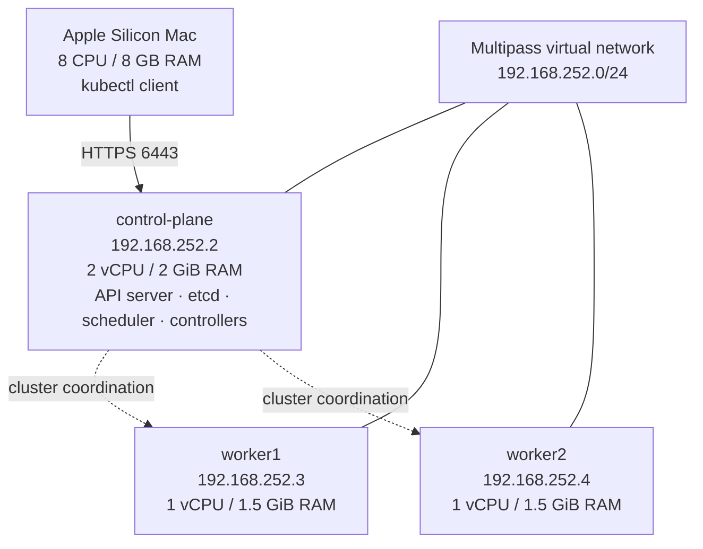
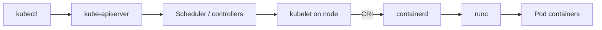

# Cluster architecture

[← Project overview](../README.md)

## Topology

## Container execution

## Verified configuration

| Component | Version or setting |
|---|---|
| Host | Apple Silicon, ARM64, 8 GB RAM |
| Virtualization | Multipass 1.17.0 + Ubuntu 24.04 |
| Kubernetes | v1.37.2, kubeadm |
| Runtime | containerd 2.2.1, systemd cgroups |
| CNI | Calico v3.33.0 via Tigera Operator |
| Pod CIDR | `10.244.0.0/16` |
| Service CIDR | `10.96.0.0/12` |
| Worker disks | 15 GB virtual disk, approximately 14 GB root filesystem |

These are the *recorded* lab addresses. New Multipass deployments may use different addresses. The Mac has limited RAM, so heavyweight monitoring stacks should not be installed without sizing adjustments.
